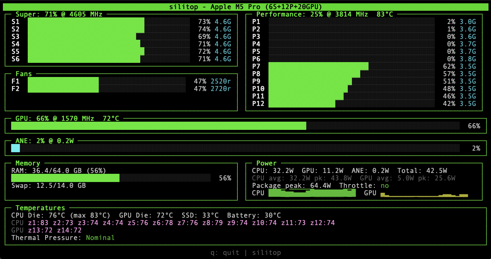

# silitop

A lightweight, native Apple Silicon performance monitor for macOS, inspired by [asitop](https://github.com/tlkh/asitop).

silitop shows per-core CPU activity, GPU and ANE use, fans, power, network and disk throughput, memory pressure, temperatures, and thermal pressure in one terminal dashboard.



## Why the native version

silitop is now one dependency-free Swift executable. The dashboard no longer needs Python, curses, recurring temperature/fan helper processes, or temporary plist files. After startup, its only recurring child is Apple's `powermetrics`.

The native event loop reads `powermetrics` records directly from a bounded pipe, samples memory and sensors in-process, and draws each frame with one terminal write. Collection failures are never displayed as zero: an affected panel says `unavailable`, or retains its last good value with a visible `stale Ns` age. If only the swap query fails, the rest of the memory panel stays live and its swap field says `unavailable`.

## Features

- Per-core CPU bars with one-based labels, utilization, and frequency fallback
- Automatic M1–M5+ core-tier names and counts
- GPU utilization, core count, and frequency
- Apple Neural Engine power and estimated utilization
- Fan RPM and maximum-speed percentage, including confirmed fanless Macs
- CPU, GPU, ANE, package power, moving averages, peaks, and history
- Network and disk throughput with history
- Activity Monitor-style memory math plus native swap readings
- Classified CPU/GPU die zones, SSD and battery temperatures
- Thermal pressure and visible stale/unavailable states
- Responsive resize, signal-safe cleanup, and concurrent-instance support
- No third-party packages or configuration files

## Requirements

- Apple Silicon Mac (M1 or later)
- macOS 13 Ventura or later
- Xcode Command Line Tools for installation (`xcode-select --install`)
- `sudo` for the dashboard because Apple restricts `powermetrics`

`--test-temps` does not require root and does not start the dashboard or `powermetrics`.

## Installation

```bash
git clone https://github.com/aylee1024/silitop.git
cd silitop
bash install.sh
```

The installer builds a stripped release executable in a temporary directory as your user, deletes that directory when it finishes, then atomically installs the binary at `/usr/local/bin/silitop` as `root:wheel` mode `0755`. Set `SILITOP_INSTALL_DIR` to choose another directory.

Upgrade by running `bash install.sh` again. The installer removes helper binaries left by older Python-based releases.

Uninstall with:

```bash
bash install.sh --uninstall
```

## Usage

```bash
sudo silitop
```

| Flag | Default | Description |
|---|---:|---|
| `--interval N` | `1` | Sampling interval in seconds; minimum 1 |
| `--color N` | `2` | 0=white, 1=red, 2=green, 3=yellow, 4=blue, 5=magenta, 6=cyan |
| `--avg N` | `30` | Power averaging window in seconds; must be at least the interval |
| `--test-temps` | — | Print temperature readings and exit without root |

Press `q`, `Esc`, or Ctrl-C to quit. The original terminal mode, cursor, and screen are restored on normal quit, signals, startup failure, or a stalled stream. After a good sample, if `powermetrics` exits, silitop starts it again and keeps the last frame.

## Architecture

```text
silitop (native Swift executable)
  ├─ kqueue: terminal input, resize/signals, child pipes/exits, stall timer
  ├─ powermetrics (one recurring child; NUL-delimited plist on stdout)
  ├─ host_statistics64 + sysctlbyname (memory, swap, topology)
  ├─ IORegistry AGXAccelerator gpu-core-count (one startup read)
  ├─ IOHIDEventSystemClient (persistent temperature collector)
  └─ AppleSMC / IOKit (persistent fan collector)
```

The running process creates no files. `powermetrics` is started with no output file, so samples stay on its stdout pipe. `--handle-invalid-values` makes a NaN reading data instead of an abort. Passing `-o -` is not used: this `powermetrics` treats that as a file named `-` and appends every sample to it. The full `cpu_power,gpu_power,thermal,network,disk` sampler set is attempted first. If that set is rejected before a valid record, silitop retries once with the essential CPU/GPU/thermal set. Malformed or oversized records are skipped; a missing section only disables its own panel. A non-finite idle ratio drops that core or the GPU panel and leaves the rest of the sample. A stream with no valid plist for `max(3 seconds, 3 × interval)` before the first good sample exits cleanly with a diagnostic. After a good sample, a dead collector is restarted. Three immediate exits with no new sample still quit, so a broken launch cannot spin. The installer builds in a temporary directory and deletes it when it finishes.

Temperature access uses private IOHID symbols that are resolved at runtime so a missing or changed API produces an explicit unavailable state instead of a launch failure. Sensor handles stay open and are rebuilt after read failures. Warm temperature work is bounded below the 20 ms p99 release gate on the M5 Pro reference system.

## Development

```bash
swift test
swift build -c release --product silitop
bash -n install.sh
```

CI verifies tests, release compilation, installer syntax, and the macOS 13 minimum deployment target. A real Ventura Mac or VM is still required before claiming Ventura runtime compatibility because current hosted runner images no longer provide the standard macOS 13 environment.

## License

MIT
